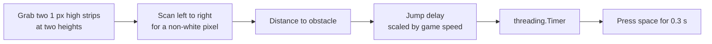

# DinoBot

A bot that plays Chrome's offline dinosaur game by looking at the screen. Best score: 6201.

## The problem

The dino game gets faster the longer you survive, so a fixed reaction rule stops working after a few hundred points. I wanted a bot that keeps up using only what a player has: the pixels on screen and the space bar.

## What I built

A 54 line Python script. It grabs two thin strips of the screen in front of the dinosaur, finds the nearest obstacle, and schedules a jump for the moment the obstacle arrives.

## Architecture



## Design decisions

- Two 1 pixel high strips instead of full frames. A screenshot of the whole game is slow, and the bot's reaction time is bounded by the capture. A strip 1090 px wide and 1 px high, sampled every 5 px, is enough to see an obstacle.
- Two strips at different heights, so an obstacle that doesn't cross the lower line is still seen.
- The jump is scheduled, not immediate. The delay is proportional to the obstacle's distance, minus the time the capture itself took, so a slow frame doesn't make the jump late.
- The game speeds up, so the delay shrinks on a schedule tied to the number of frames processed (at 80, 150, 280, 450, 800, 1200 and 2000 loops). The factors were tuned by hand.
- The key press runs on a timer thread so the main loop keeps watching for the next obstacle while the dino is in the air.

## Setup

```bash
python3 -m venv .venv && .venv/bin/pip install -r requirements.txt
```

## Run

Open `chrome://dino` in Chrome, start the game, then:

```bash
.venv/bin/python main.py
```

On macOS the terminal needs Screen Recording and Accessibility permission.

## Limits

The capture coordinates are hardcoded for my screen: the strips are at y=710 and y=654, from x=180 to x=1270. On another display or window size, change the two `bbox` values in `main.py` so they cross the ground line just in front of the dinosaur. It also assumes the light theme, since it treats anything not white as an obstacle.
